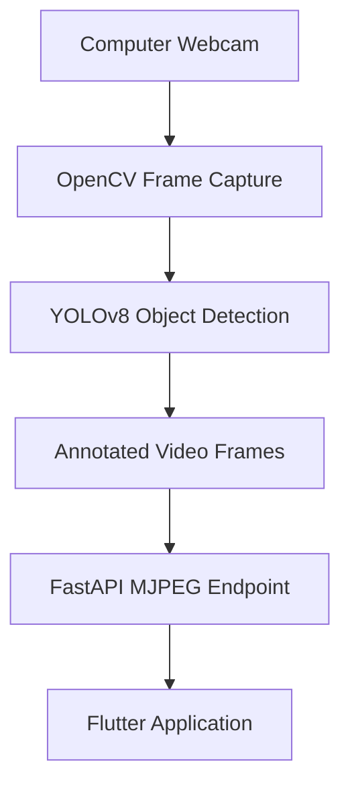

# AI Phone — Real-Time Object Detection

AI Phone is an ongoing computer-vision project that combines a Flutter application with a Python-based backend to perform real-time object detection using YOLOv8.

The current prototype captures video from a computer's webcam, processes each frame using an Ultralytics YOLOv8 model, and streams the annotated video to a Flutter application through a FastAPI backend.

The project is being developed in stages, starting with a local desktop and browser experience before exploring mobile camera integration, remote video streaming, and external camera hardware.

## Demo

*Screenshots and demonstration GIFs will be added as development progresses.*

## Project Status

**Under Active Development** 🚧

The current implementation supports local webcam capture, YOLOv8 object detection, MJPEG video streaming, and a Flutter interface.

Mobile camera integration, remote backend hosting, and Raspberry Pi camera support are planned future improvements and are not currently implemented.

## Features

### Implemented

- Real-time object detection using YOLOv8 Nano.
- Webcam video capture using OpenCV.
- Object localization with bounding boxes and class labels.
- Python backend powered by FastAPI.
- MJPEG video streaming.
- Flutter interface for displaying processed video.
- Local browser and Windows desktop execution.

### Planned

- Mobile camera integration.
- Remote backend deployment.
- Configurable camera sources.
- Raspberry Pi camera integration.
- Network-based video streaming.
- Improved camera connection and error handling.
- Additional computer-vision capabilities.

## Technology Stack

| Component | Technology |
|---|---|
| Frontend | Flutter / Dart |
| Backend | Python |
| API Framework | FastAPI |
| Computer Vision | OpenCV |
| Object Detection | Ultralytics YOLOv8 |
| Video Streaming | MJPEG |
| Model | YOLOv8 Nano (`yolov8n.pt`) |

## Architecture

The current prototype uses a local processing architecture.



### Processing Workflow

1. The Python backend accesses the computer's default webcam using OpenCV.
2. Each captured frame is passed to the YOLOv8 Nano model.
3. YOLOv8 identifies recognized objects and their locations.
4. The backend draws bounding boxes and class labels on the frames.
5. FastAPI exposes the processed frames through an MJPEG stream.
6. The Flutter application connects to the endpoint and displays the live video.

## YOLOv8 Object Detection

This project uses **YOLOv8 Nano (`yolov8n.pt`)**, a lightweight object-detection model developed by Ultralytics.

YOLO stands for *You Only Look Once*. It processes an image and predicts the locations and classes of objects within that image.

### COCO Dataset

The pretrained YOLOv8 Nano model uses the **COCO (Common Objects in Context) dataset**, which contains 80 object categories.

These categories cover a variety of everyday objects, including people, vehicles, animals, food, furniture, electronics, and sports equipment.

### Supported Object Categories

The following table lists the 80 categories supported by the standard pretrained COCO model.

| Category | Recognized Objects |
|---|---|
| People | Person |
| Vehicles | Bicycle, car, motorcycle, airplane, bus, train, truck, boat |
| Traffic objects | Traffic light, fire hydrant, stop sign, parking meter, bench |
| Accessories | Backpack, umbrella, handbag, tie, suitcase |
| Animals | Bird, cat, dog, horse, sheep

## Requirements

- Python 3.10 or newer
- Flutter SDK
- Dart SDK 3.8.1 or newer
- A webcam connected to the computer
- Google Chrome for browser execution
- Visual Studio with the Desktop development with C++ workload for Windows desktop execution

## Installation and Setup

### 1. Clone the Repository

```bash
git clone https://github.com/navin20/AI-Phone.git
cd AI-Phone
```

### 2. Set Up the Python Backend

Navigate to the backend directory:

```bash
cd backend
```

Create a virtual environment.

**Windows:**

```powershell
py -m venv venv
.\venv\Scripts\activate
```

**macOS / Linux:**

```bash
python3 -m venv venv
source venv/bin/activate
```

Install the backend dependencies:

```bash
python -m pip install --upgrade pip
python -m pip install fastapi uvicorn ultralytics opencv-python
```

### 3. Prepare the YOLOv8 Model

The project uses `yolov8n.pt`.

The model file is expected in the `backend` directory. If it is missing, Ultralytics can download the pretrained weights when they are first loaded.

```bash
python -c "from ultralytics import YOLO; YOLO('yolov8n.pt')"
```

An internet connection is required for the initial download.

### 4. Start the Backend

From the `backend` directory:

```bash
python main.py
```

Keep the backend running while using the Flutter application.

The backend uses the computer's default webcam, so ensure camera permissions are enabled and that another application is not already using it.

### 5. Set Up the Flutter Application

Open another terminal and navigate to the mobile application directory:

```bash
cd mobile
```

Check the Flutter installation:

```bash
flutter doctor
```

Install the Flutter dependencies:

```bash
flutter pub get
```

### 6. Run in Google Chrome

With the backend running:

```bash
flutter run -d chrome
```

The browser and backend must run on the same computer because the current application connects to `localhost:8000`.

### 7. Run as a Windows Desktop Application

Enable Windows desktop support if necessary:

```bash
flutter config --enable-windows-desktop
```

Check available devices:

```bash
flutter devices
```

Launch the application:

```bash
flutter run -d windows
```

The Python backend must remain running in a separate terminal.

## API Reference

### Video Stream

| Method | Endpoint | Description |
|---|---|---|
| GET | `/video_test` | Returns the annotated MJPEG video stream |

**Local URL:**

```text
http://localhost:8000/video_test
```

The endpoint continuously provides processed webcam frames for the Flutter application.

## Project Structure

```text
AI-Phone/
│
├── backend/
│   ├── main.py
│   └── yolov8n.pt
│
├── mobile/
│   └── lib/
│       └── main.dart
│
├── LICENSE
├── README.md
├── THIRD_PARTY_NOTICES.md
└── ...
```

## Troubleshooting

### Video Stream Is Blank

- Check that the Python backend is running.
- Open `http://localhost:8000/video_test` in a browser.
- Confirm that the Flutter application is using the correct stream URL.

### Webcam Cannot Be Opened

- Check operating system camera permissions.
- Ensure a webcam is connected.
- Close applications that may already be using the camera.
- The current implementation uses camera index `0`.

### YOLOv8 Model Cannot Be Found

- Confirm that `yolov8n.pt` exists inside the `backend` directory.
- Start the backend from the `backend` directory.
- Check that the model path in `main.py` matches the actual file location.

### Flutter Cannot Find Chrome or Windows

Run:

```bash
flutter doctor
flutter devices
```

Install any missing platform dependencies reported by Flutter.

### Cannot Access the Application From a Phone

Mobile access is not currently configured.

The application connects to `localhost:8000`, and the backend processes the computer's webcam rather than the phone's camera.

Future mobile support will require a reachable backend address and appropriate camera integration.

## Current Limitations

- Local webcam capture only.
- Camera index `0` is currently used.
- Backend and Flutter application must run on the same computer.
- No remote server deployment.
- No phone camera integration.
- No Raspberry Pi camera integration.
- Object detection is limited to the supported classes of the selected model.

## Roadmap

| Stage | Development Goal | Status |
|---|---|---|
| 1 | Python webcam capture | Implemented |
| 2 | YOLOv8 object detection | Implemented |
| 3 | FastAPI video streaming | Implemented |
| 4 | Flutter video interface | Implemented |
| 5 | Improve desktop and browser experience | Planned |
| 6 | Configurable camera sources | Planned |
| 7 | Remote backend deployment | Planned |
| 8 | Raspberry Pi camera integration | Planned |
| 9 | Mobile camera integration | Planned |

## License

This project is licensed under the **GNU Affero General Public License v3.0 (AGPL-3.0)**.

See the [LICENSE](LICENSE) file for the complete license terms.

This project uses Ultralytics YOLOv8, which is distributed under AGPL-3.0 by default, with an alternative Enterprise License available.

Third-party libraries and dependencies remain subject to their respective license terms.

See [THIRD_PARTY_NOTICES.md](THIRD_PARTY_NOTICES.md) for third-party acknowledgements and licensing information.

Official licensing references:

- [GNU AGPL-3.0](https://www.gnu.org/licenses/agpl-3.0.html)
- [Ultralytics Licensing](https://www.ultralytics.com/license)

## Acknowledgements

- [Ultralytics](https://github.com/ultralytics/ultralytics) for YOLOv8 and its pretrained object-detection models.
- [Flutter](https://flutter.dev/) for the cross-platform application framework.
- [FastAPI](https://fastapi.tiangolo.com/) for the Python API framework.
- [OpenCV](https://opencv.org/) for computer-vision and video-processing capabilities.

## Author

**Navin Singh**

GitHub: [@navin20](https://github.com/navin20)

---

*AI Phone is a computer-vision development project. Features and architecture are subject to change as development continues.*
